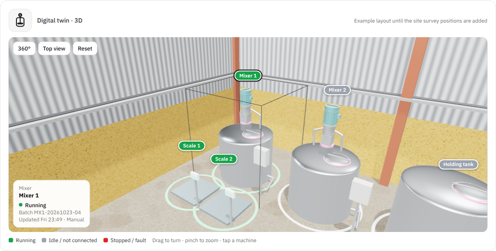

# Artifacts

Everything made for OmniSite. Items marked *earlier session* were made in other sessions and are not in this folder; ask Devin to regenerate or add them.

## Images
| File | What |
|---|---|
| [10_chemex_3d_sample.png](images/10_chemex_3d_sample.png) | Realistic 3D sample of a Chemex hall (example layout) |
| [11_chemex_3d_mixer.png](images/11_chemex_3d_mixer.png) | 3D sample: Mixer 1 selected |
| [12_dashboard_twin_live.png](images/12_dashboard_twin_live.png) | Live factory dashboard twin (Demo factory) |
| [13_crm_twin_hologram.png](images/13_crm_twin_hologram.png) | CRM survey twin (hologram style) |
| [14_walk_mode_mockup.png](images/14_walk_mode_mockup.png) | Walk-mode mockup |
| [1_error_vs_distance.png](images/1_error_vs_distance.png) | Simulation: phone error vs distance walked |
| [2_error_by_method.png](images/2_error_by_method.png) | Simulation: error by method |
| [3_example_walk.png](images/3_example_walk.png) | Simulation: one example walk |
| [4_marker_layout.png](images/4_marker_layout.png) | Top view: markers every 2 m + laser shots |
| [5_swarm_units.png](images/5_swarm_units.png) | Swarm simulation: error vs number of units |
| [6_site_test_3d.png](images/6_site_test_3d.png) | 3D schematic: site accuracy test |
| [7_swarm_3d.png](images/7_swarm_3d.png) | 3D schematic: how the swarm moves |
| [8_site_test_realistic.png](images/8_site_test_realistic.png) | AI-generated illustration (not a real photo): site test |
| [9_swarm_realistic.png](images/9_swarm_realistic.png) | AI-generated illustration (not a real photo): drone swarm concept |

## Interactive / video
| File | What |
|---|---|
| [twin3d/Chemex_3D_Twin_Sample.html](twin3d/Chemex_3D_Twin_Sample.html) | Realistic 3D sample of the 15 Chemex machines (open in a browser) |
| [twin3d/OmniSite_Floor_Twin_Phase1_Mockup.html](twin3d/OmniSite_Floor_Twin_Phase1_Mockup.html) | Floor plan + walk mode + twin mockup |
| [sim/OmniSite_markers_explained.mp4](sim/OmniSite_markers_explained.mp4) | Animation: drift vs markers (schematic) |

## Documents
| Document | Where |
|---|---|
| [Progress checklist](progress_checklist.md) | This folder (converted from Word) |
| Engineer Execution Plan (docx / pdf) | *earlier session* (~/omni_docs/ep.py) |
| Chemex pilot quotation (docx) | *earlier session* (~/omni_docs/qt.py) |
| Chemex procurement pack (POs + work order, xlsx / pdf) | *earlier session* |
| Chemex equipment schematic (PNG / SVG) | *earlier session* |
| Margaflow scope summary (no prices) | *earlier session* |
| Hi2 pack: NDA, dev & IP agreement, pilot agreement, letter to dev team | *earlier session* (Salamah has the files) |
| Arabic feasibility study | Salamah |
| Chemex P&ID, Preliminary Site Survey Report | Salamah (confidential) |
| Digit88 "Building with AI…" (NEXUS Incubator) | Salamah; gap review in [01_knowledge/06_security.md](../01_knowledge/06_security.md) |

## Simulation scripts
See [06_code/rnd_simulations.md](../06_code/rnd_simulations.md).
